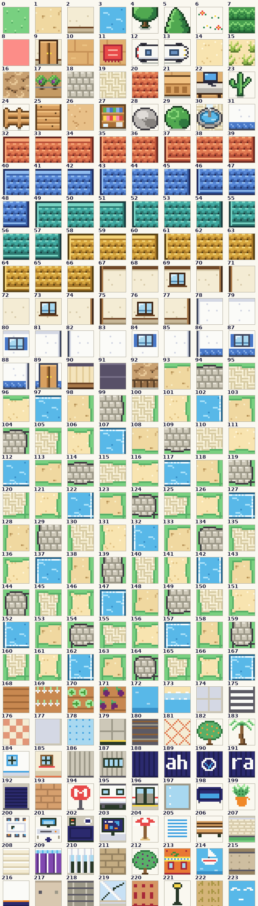

# Sprite specs for artists

The brief for hand-drawing Flexymon's sprites. Every sprite is a PNG with transparency, drawn on a 32 px grid for a
512 × 288 screen, in a Game Boy Color–style pixel-art look. A finished file replaces the code-drawn placeholder at
the same path and size; no code changes are needed. The pipeline behind the placeholders is in [ART.md](ART.md).

## Ground rules

Draw small, then double: most art is designed at half size and scaled ×2 with nearest-neighbour, so every visible
pixel is a 2 × 2 block.

| Rule | Spec |
| --- | --- |
| Screen | 512 × 288 px (16 × 9 tiles of 32 px), shown pixel-perfect and scaled up to fit the window |
| Format | PNG, 32-bit RGBA, transparent background (except the title and tileset) |
| View | Top-down, slightly 3/4: roofs and tree crowns from above, building fronts and doors from the front |
| Pixels | Solid colours only: no anti-aliasing, no gradients, no semi-transparent edges |
| Outline | Dark outline on every object (near-black brown or navy; never pure black on big areas) |
| Shading | 2–3 shades per hue (light, base, shadow); light comes from the top-left |
| Ground | A subtle repeating pattern (dots, dashes, herringbone, cobbles) so big areas never look flat |
| Palette cues | Mint grass `#58c890`, sandy paths `#e8d090`, cream plazas `#f0ecd0`, teal water `#38a8b8`, terracotta / blue / teal / ochre roofs |
| Theme | Cartoon Valencia: orange trees, terracotta roofs, blue-and-white tiled domes, palms, beach, Turia gardens, offices |

The flexymon are office objects brought to life (laptops, printers, chairs…). The look is a bright Game Boy Color /
Advance–era handheld RPG, but everything must be original: never copy, trace or recreate characters, buildings or
logos from existing games, and never use Nintendo assets or the word "Pokémon".

## Flexymon (12 creatures × 3 files = 36 files)

Each creature needs a front, a back and a small icon. Design on a 32 × 32 canvas and export it doubled to 64 × 64.

| File | Size | Design at | Shown where |
| --- | --- | --- | --- |
| `<id>_front.png` | 64 × 64 | 32 × 32, scaled ×2 | Battle, the opponent (top right); team and storage detail pages |
| `<id>_back.png` | 64 × 64 | 32 × 32, scaled ×2 | Battle, your own flexymon (bottom left), seen from behind |
| `<id>_icon.png` | 16 × 16 | 16 × 16 (no scaling) | Team list, storage box, menus |

Keep a 1 px transparent margin and stand the creature on the bottom edge: it sits on a grassy platform in battle.
The front shows a face (eyes, mouth, blush); the back shows the object's rear (cables, vents, paper slot…).

| Id (file prefix) | In-game name | What it is |
| --- | --- | --- |
| `portatil` | Portátil | Laptop |
| `raton` | Ratón | Computer mouse |
| `teclado` | Teclado | Keyboard |
| `monitor` | Monitor | Monitor |
| `movil` | Móvil | Mobile phone |
| `impresora` | Impresora | Printer |
| `cafetera` | Cafetera | Coffee machine |
| `grapadora` | Grapadora | Stapler |
| `silla` | Silla ergonómica | Ergonomic office chair |
| `servidor` | Servidor | Server rack |
| `router` | Router | Wi-Fi router |
| `proyector` | Proyector | Projector |

Folder: `public/assets/sprites/flexymon/`, e.g. `raton_front.png`, `raton_back.png`, `raton_icon.png`.

## Player and NPCs (41 walk sheets)

Every character is one 64 × 128 walk sheet: 8 frames of 32 × 32, designed at 16 × 16 per frame and scaled ×2.
Characters are about 1 tile wide and 1.5 tiles tall, with a big head and a short body.

Sheet layout (x, y = the frame's top-left pixel):

| Row | Column 1: standing (x 0) | Column 2: mid-stride (x 32) |
| --- | --- | --- |
| Facing down (y 0) | stand | step |
| Facing left (y 32) | stand | step |
| Facing right (y 64) | stand | step |
| Facing up (y 96) | stand | step |

The game alternates the two columns while walking. Keep the feet in the same spot in every frame so the character
does not jitter. Any NPC file that is not 64 × 128 is shown as one still image that never turns.

The player is `public/assets/sprites/player.png`. NPC sheets go in `public/assets/sprites/npcs/`; several characters
share one sheet (`npcs.json › sprite`), so each sheet should read as a type:

| File | Used for |
| --- | --- |
| `abuelo.png` | Old man, neighbour, fallero (5 NPCs) |
| `banista.png` | Bather, stroller (3) |
| `becario.png` | Intern |
| `camarera.png` | Waitress |
| `camarero.png` | Waiter, cook (2) |
| `ciclista.png` | Cyclist, runner (3) |
| `cliente.png` | Customer (2) |
| `comercial.png` | Salesperson, assistant (2) |
| `companera.png` | Coworker, developer; also the intro coworker (2) |
| `consultor.png` | Consultant, coworker, designer (3) |
| `encargado.png` | Manager, truck driver (2) |
| `enologa.png` | Winemaker |
| `estudiante.png` | Student, traveller (2) |
| `funcionaria.png` | Civil servant |
| `hortelano.png` | Market gardener, farmer (3) |
| `informatico.png` | IT guy |
| `jefe.png` | Project manager (a boss) |
| `maquinista.png` | Ticket sellers, station master (4) |
| `mp.png` | M.P. (a boss) |
| `murciano.png` | Man from Murcia |
| `nina.png` | Children (4) |
| `operario.png` | Worker, neighbour (2) |
| `pescador.png` | Fisherman / fisherwoman (3) |
| `ponente.png` | Conference speaker |
| `recepcionista.png` | Receptionist |
| `recolectora.png` | Fruit picker, seasonal worker (2) |
| `repartidor.png` | Delivery rider, haulier (2) |
| `socorrista.png` | Lifeguard |
| `surfera.png` | Surfer |
| `tendera.png` | Shopkeeper, woman (2) |
| `tendero.png` | Shopkeeper, man (2) |
| `turista.png` | Tourist, tour guide (5) |
| `vecina.png` | Neighbour, horchata seller, holidaymaker, vendor (6) |

The story realm's seven bosses (`story.json › bosses`) each have their own sheet, in the same folder:

| File | Boss (landmark) |
| --- | --- |
| `guardiana.png` | Guard in grey armour (Torres de Serranos) |
| `frutera.png` | Fruit seller with an apron (Mercado Central) |
| `fallera.png` | Fallera in a festival dress (the bullring) |
| `paellero.png` | Paella cook (Malvarrosa beach) |
| `cientifica.png` | Scientist in a lab coat (Ciutat de les Arts) |
| `jefa_estacion.png` | Station master with a cap (Estació del Nord) |
| `barquera.png` | Old boatwoman with a straw hat (the Albufera) |

## Items (8 icons)

Item icons are 16 × 16, drawn at that size (not doubled), and shown in the bag, the shops and battle. Folder:
`public/assets/sprites/items/`.

| File | Item | What it does in the game |
| --- | --- | --- |
| `cafe.png` | Café | Heals 20 HP |
| `bocadillo.png` | Bocadillo (sandwich) | Heals 50 HP |
| `ibuprofeno.png` | Ibuprofeno (painkiller) | Revives a fainted flexymon |
| `lata.png` | Lata energética (energy drink can) | Raises attack for 3 turns |
| `regleta.png` | Regleta (power strip) | One more team slot |
| `llaves.png` | Llaves del Audi (car keys) | Key item: drive the office Audi |
| `carnet.png` | Carnet de conducir (driving licence) | Key item |
| `cafe_doble.png` | Café doble (double coffee) | Key item for the drive to Murcia |

## World tileset (226 tiles, one sheet)

The whole world is drawn from one sheet, `public/assets/tilesets/world.png`: 256 × 928 px, 8 columns × 29 rows of
32 × 32 tiles. Design each tile at 16 × 16 and scale ×2. Tile ids count left to right, top to bottom
(id = row × 8 + column).

Every map stores tile ids, so **each tile must stay at its exact position**: redraw a tile in place, never reorder,
insert or remove. Neighbouring tiles must join seamlessly (grass into path, roof edges, shorelines). Once a
hand-drawn tileset is in, never run `npm run world -- --force`: it redraws the sheet from code
([MAPS.md](MAPS.md)).

| Ids | Group |
| --- | --- |
| 0–31 | Base tiles: grass, path, walls, water, trees, flowers, tall grass, door, floor, sand, desert, roads, roofs, furniture, fences, rocks, fountain (list below) |
| 32–66 | Roof edges and corners, in four roof colours (terracotta, blue, teal, ochre) |
| 67–91 | Building façades: wall edges, windows, white walls, a second door |
| 92–167 | Borders where grass meets path, plaza paving, sand and water (edges, corners, shore foam) |
| 168–225 | Special tiles: huerta crops, sea, stations and trains, the office and its logo, the Turia park, shops, beach, lampposts; 224 the office's mystery door (a violet door with a "?"), 225 a stop on the story map's path (a round stone on sand) |

Base tiles (0–31):

| Id | Tile | Id | Tile |
| --- | --- | --- | --- |
| 0 | Grass | 16 | Mountain |
| 1 | Path | 17 | Vineyard (wild flexymon area) |
| 2 | Wall | 18 | Road |
| 3 | Water | 19 | Plaza paving |
| 4 | Tree trunk | 20 | Roof |
| 5 | Tree crown | 21 | Counter |
| 6 | Flowers | 22 | Desk |
| 7 | Tall grass (wild flexymon area) | 23 | Cactus |
| 8 | Collision marker (never shown; leave as is) | 24 | Fence |
| 9 | Door | 25 | Bridge |
| 10 | Wooden floor | 26 | Desert ground |
| 11 | Doormat | 27 | Shelf |
| 12–13 | The Audi from above, rear and front | 28 | Rock |
| 14 | Sand | 29 | Bush |
| 15 | Dune grass (wild flexymon area) | 30 | Fountain |
| | | 31 | White wall |

Every tile of the current sheet, numbered by id, at ×2 (`images/tileset-reference.png`; redraw it whenever the
tile order or tile art changes):

## Title screen, car and minimaps

| File | Size | Design at | Notes |
| --- | --- | --- | --- |
| `public/assets/ui/title.png` | 512 × 288 | 256 × 144, scaled ×2 | Full-screen title picture, no transparency. The game writes "Flexymon" and the menu over it, so keep the centre calm. Today it shows the office front. |
| `public/assets/sprites/car/audi.png` | 96 × 40 now (any size works) | 48 × 20, scaled ×2 | The office Audi in side view, nose to the right, transparent background. Shown driving during the trip to Murcia. |
| `public/assets/ui/minimap_<zone>.png` | Any; shrunk to fit 128 × 96 | — | Optional. One map picture per outdoor zone: `valencia`, `alboraya`, `pueblo`, `murcia`. Must match the map's layout, since the player's dot is placed by tile. |

The intro coworker reuses `companera.png`, and menu boxes are drawn by code, so neither needs a separate file.

## Delivery

The full set is 81 files: 36 flexymon, 34 characters, 8 items, the tileset, the title and the car (plus 4 optional
minimaps). Files can arrive in any order and in batches; anything not delivered keeps its placeholder.

1. Start from the current placeholder: each one is already the right size and layout, so it works as a template.
   They are all in the repo under `public/assets/`.
2. Name each file exactly as listed here (lowercase, no accents, same folder). A different name or size will not be
   picked up.
3. Export at the final size (the ×2 version where this page says so), PNG with transparency.
4. Drop the files in at the same paths, check them in the running game on desktop and phone, and mention the
   hand-made files in the commit (`npm run art -- --force` would redraw them from code).

Suggested order, by how often players see it:

1. Player sheet and the 12 flexymon (front, back, icon)
2. Tileset base tiles 0–31, then their borders and variants
3. Title screen
4. NPC sheets, starting with the bosses (`jefe`, `mp`) and `companera`
5. Items, the car and the special tiles 168–225

Keep the layered source files (Aseprite, Photoshop…) too: hand-made PNGs replace the code-drawn art, so later edits
are made in those sources.

When a sprite, NPC sheet, item or tile is added or renamed, update this page with it.
